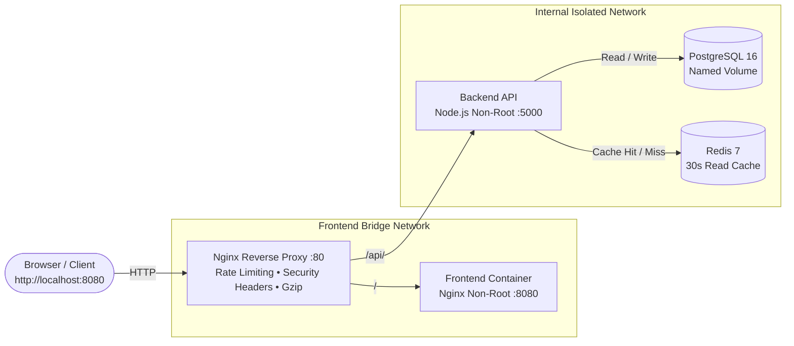

```markdown
# Project 01: Multi-Tier Web App with Docker Compose & Nginx Reverse Proxy

[](https://hub.docker.com/u/auladdevops)
[](https://nginx.org/)
[](https://nodejs.org/)
[](https://www.postgresql.org/)
[](https://redis.io/)

A production-style **3-Tier Web Application** orchestrated with **Docker Compose**, featuring **Nginx Reverse Proxy**, a static **Frontend**, a **Node.js REST API**, **PostgreSQL 16**, and **Redis 7** caching. Designed to demonstrate container hardening, network segmentation, automated health checks, and reverse proxy traffic management.

---

## System Architecture



---

## Key DevOps & Security Highlights

* **Multi-Stage Builds & Minimal Base Images:** Uses multi-stage `alpine` Dockerfiles to reduce image footprint and minimize attack surface.
* **Non-Root Container Execution:** Hardened runtime security by running `frontend` (`nginx`) and `backend` (`appuser`) as dedicated non-root users.
* **Network Isolation:** Segregates traffic across `frontend-net` and an `internal: true` `backend-net`, preventing direct external access to PostgreSQL and Redis.
* **Nginx Reverse Proxy & API Gateway:** Configured `/api/` rate limiting (`10r/s`, `burst=20`), Gzip compression, and HTTP security headers.
* **Resilient Startup & Health Checks:** Implements native Docker `HEALTHCHECK` probes alongside `depends_on: condition: service_healthy` to enforce deterministic startup order.
* **Caching & Data Persistence:** Integrates Redis (`30s` read cache) to reduce database load and Docker named volumes for persistent PostgreSQL storage.

---

## Quick Start

### 1. Clone & Navigate

```bash
git clone [https://github.com/auladwd/devops-portfolio-projects.git](https://github.com/auladwd/devops-portfolio-projects.git)
cd devops-portfolio-projects/01-multi-tier-docker-nginx

```

### 2. Configure Environment (Optional)

```bash
cp .env.example .env

```

### 3. Build & Run

```bash
docker compose up -d --build

```

### 4. Verify Health & Endpoints

```bash
docker compose ps
curl http://localhost:8080/nginx-health
curl http://localhost:8080/api/health
curl http://localhost:8080/api/tasks

```

Access the web interface at `http://localhost:8080`.

### 5. Stop & Clean Up

```bash
docker compose down      # Add -v to remove persistent volumes

```

---

## Docker Hub Registry

Pre-built images are hosted on Docker Hub under [`auladdevops`](https://hub.docker.com/u/auladdevops).

```bash
# Set DOCKERHUB_USERNAME=auladdevops in .env
docker login
docker compose build
docker compose push

```

---

## CV / Resume Summary

* *Architected and containerized a multi-tier web application (Frontend, Node.js REST API, PostgreSQL, Redis) using multi-stage Alpine Dockerfiles and non-root container users (`nginx`, `appuser`).*
* *Configured Nginx as a reverse proxy with rate limiting, Gzip compression, and security headers, isolating database and cache layers inside an `internal` Docker bridge network.*
* *Implemented automated container health checks, persistent named volumes, and Redis caching, publishing versioned images to Docker Hub (`auladdevops`).*

```
screeshot:
```